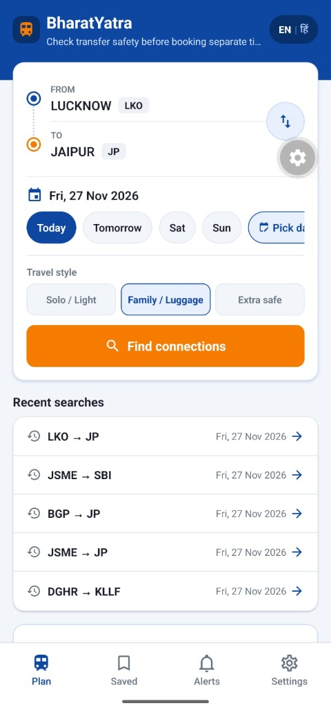
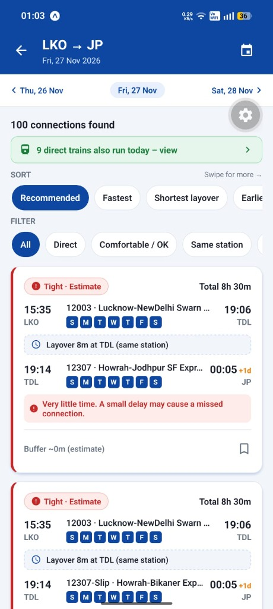
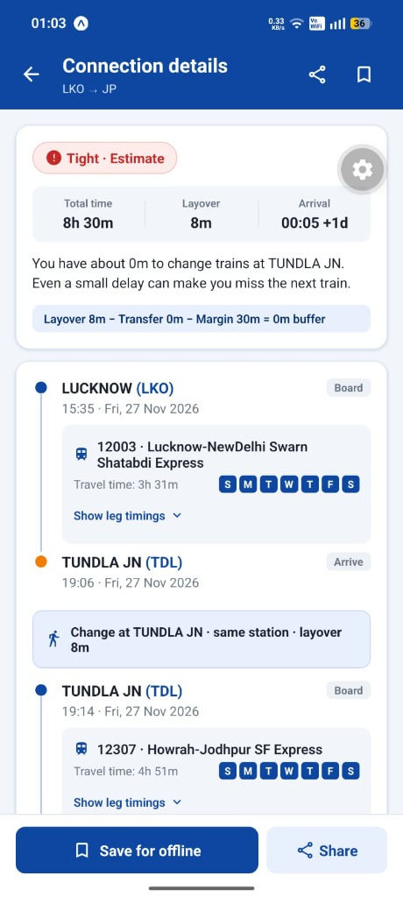
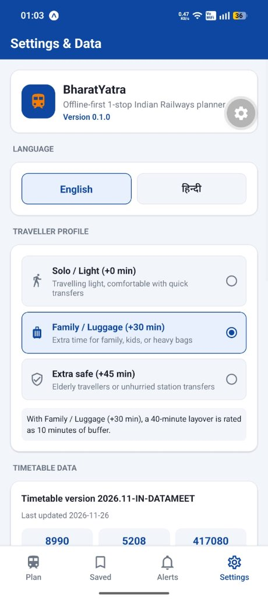

<div align="center">
  
  <h1>BharatYatra</h1>
  <p><strong>Offline-First 1-Stop Train Connection Planner for Indian Railway Passengers</strong></p>
</div>

[](./frontend)
[](./backend)
[](./docs/DATA_FORMAT.md)
[](./frontend/src/i18n)
[-1B7F3B?style=flat-square&logo=android&logoColor=white)](https://expo.dev/accounts/baby_coda_69/projects/bharatyatra/builds/d20da46a-a16d-4b1e-a77c-e7445e672ac6)

## Download Android App

- **Android APK (v0.1.1):** [Download from Expo EAS Build](https://expo.dev/accounts/baby_coda_69/projects/bharatyatra/builds/d20da46a-a16d-4b1e-a77c-e7445e672ac6) *(install directly on Android; connects automatically to the live BharatYatra backend)*

> **Official Notice & Scope Disclaimer:**
> **BharatYatra** is a **pre-booking schedule planning utility** for passengers travelling on **two separate tickets** when direct trains are unavailable or waitlisted. It does **not** book tickets, display seat availability, track coach positions, or provide live train running status. All buffer ratings (`Tight`, `OK`, `Comfortable`, `Too long`, `Transfer time unknown`) are **rule-based schedule estimates**, never probabilities or live delay guarantees. Always verify live running status and book tickets on official Indian Railways platforms (**IRCTC**, **NTES**, **RailOne**).

---

## Application Screenshots

| Plan (Home) | Connection Options | Connection Details | Settings & Data |
| :---: | :---: | :---: | :---: |
|  |  |  |  |

---

## Key Capabilities

### 1. Pre-Booking 1-Stop Connection Planning
- **National Timetable Coverage:** Searches across **8,990 stations**, **5,208 trains**, and **417,080 scheduled stops** (`2026.11-IN-DATAMEET`) via the live MongoDB Atlas + Node.js API, with automatic offline SQLite fallback.
- **Same-Station & City-Cluster Transfers:** Supports transfers at the same junction as well as across stations in major metropolitan clusters (`DELHI_NCR`, `MUMBAI_MMR`, `KOLKATA`, `CHENNAI`, `BENGALURU`, `HYDERABAD`).
- **Overnight & Weekday Accuracy:** Evaluates `runningDays` (Mon–Sun bitmask) against each train's **origin departure date** (`dayOffset`) in IST (`0..1439` minutes from midnight).
- **Direct Train Comparison:** Surfaces direct trains running on the selected route and date in a dedicated banner and bottom sheet, plus a **Direct** filter chip.

### 2. Passenger Safety & Buffer Signals
- **Rule-Based Buffer Ratings:** Classifies effective buffer (`layover - transfer - traveller margin`) into `Tight`, `OK`, `Comfortable`, `Too long`, or `Transfer time unknown` with paired icons and color-blind-safe badges. **`Tight` connections are never hidden.**
- **Traveller Buffer Profiles:**
  - **Solo / Light (`+0 min`)**
  - **Family / Luggage (`+30 min`)**
  - **Extra safe (`+45 min`)**
- **Late-Night Transfer Warnings:** Flags layovers overlapping **23:00–05:00 IST** when local inter-station transport is sparser.
- **Journey Continuity & Offline Access:** Bookmark any connection for offline access, share WhatsApp-ready journey summaries, inspect "Before you book" checklists (IRCTC/NTES deep links), and view next-3 backup departures if Train 2 is missed.
- **Bilingual UI:** Full **English** and **हिन्दी (Hindi)** support with instant switching.

---

## System Architecture

```text
Bharat_Yatra/
├── frontend/                  # React Native + Expo SDK 58 mobile application (TypeScript strict)
│   ├── app/
│   │   ├── (tabs)/            # 4-tab navigation: Plan (index), Saved, Alerts, Settings
│   │   ├── results.tsx        # Connection options list, sorting/filtering, direct trains sheet
│   │   └── connection/[id].tsx# Vertical journey timeline, buffer breakdown, IRCTC/NTES links
│   ├── src/
│   │   ├── theme/theme.ts     # Unified BharatYatra design tokens
│   │   ├── components/        # AppHeader, StationInput, DateChips, TrainCard, Timeline, StatusPill, etc.
│   │   ├── domain/            # Pure IST time, runningDays, rateConnection, searchConnections, findDirectTrains
│   │   ├── db/                # Expo SQLite schema v1, migrations, offline fallback & bookmarks
│   │   ├── config/            # Buffer thresholds & live backend API client
│   │   ├── i18n/              # English (en.json) & Hindi (hi.json) translations
│   │   └── state/             # Zustand app store
│   └── __tests__/             # Jest unit tests
├── backend/                   # Zero-dependency Node.js (>=22.5) MVC API server
│   ├── app.mjs                # HTTP server factory
│   ├── server.mjs             # Entrypoint (MongoDB Atlas primary + SQLite fallback)
│   ├── routes/apiRouter.mjs   # Route dispatcher
│   ├── controllers/           # health, station, connection, timetable controllers
│   ├── models/                # stationModel, connectionModel, timetableModel
│   ├── views/jsonView.mjs     # JSON & CORS response helpers
│   └── ingest/                # DataMeet, RailKit & MongoDB bulk importers
├── scripts/                   # Offline SQLite timetable CLI builder
├── docs/                      # Data format specification & screenshots
└── render.yaml                # Render Blueprint deployment configuration
```

---

## Live Backend API (Open Public Schedule API)

**Base URL:** [https://bharat-yatra-1bdr.onrender.com](https://bharat-yatra-1bdr.onrender.com)

Anyone building railway utilities, prototypes, or research tools can query the public BharatYatra API directly (CORS enabled for `*`, JSON responses).  
*(Note: Hosted on Render free tier — the first request after inactivity may take ~20–30s to wake up.)*

### Quick Endpoint Summary

| Method | Endpoint | Purpose |
| :--- | :--- | :--- |
| `GET` | `/health` | Service status, dataset version, and station/train/stop counts |
| `GET` | `/api/stations` | Search Indian Railways stations by code, name, or city |
| `GET` | `/api/connections` | Find 1-stop train connections, buffer ratings, and direct trains |
| `GET` | `/api/timetable` | Export the full timetable dataset as JSON |
| `POST` | `/api/timetable/import` | Validate and import a JSON timetable payload |

---

### Endpoint Details

#### 1. `GET /health`
Returns server health, active dataset metadata, and record counts.

- **Example:** `https://bharat-yatra-1bdr.onrender.com/health`
- **Sample Response:**
```json
{
  "status": "ok",
  "meta": {
    "datasetKind": "IMPORTED",
    "dataVersion": "2026.11-IN-DATAMEET",
    "lastUpdated": "2026-11-26"
  },
  "stats": {
    "stations": 8990,
    "trains": 5208,
    "stops": 417080,
    "clusters": 6,
    "transfers": 0
  }
}
```

#### 2. `GET /api/stations`
Autocomplete/search across all **8,990** Indian Railways stations.

- **Query Parameters:**
  - `q` *(optional, string)* — Station code, station name, or city (e.g., `NDLS`, `Lucknow`).
  - `limit` *(optional, number, default `30`, max `100`)* — Maximum results returned.
- **Example:** `https://bharat-yatra-1bdr.onrender.com/api/stations?q=LKO&limit=10`
- **Sample Response:**
```json
{
  "stations": [
    {
      "code": "LKO",
      "name": "LUCKNOW",
      "city": "LUCKNOW",
      "lat": 26.8318,
      "lng": 80.9191,
      "cityClusterId": null
    }
  ]
}
```

#### 3. `GET /api/connections`
Finds 1-stop train-to-train connections (sorted fastest-first) plus direct trains on the same date.

- **Query Parameters:**
  - `from` *(required, string)* — Origin station code (e.g., `LKO`).
  - `to` *(required, string)* — Destination station code (e.g., `JP`).
  - `date` *(optional, `YYYY-MM-DD`, defaults to today UTC)* — Travel date in IST.
  - `extraBuffer` *(optional, number, default `0`)* — Extra traveller safety margin in minutes (`0`, `30`, `45`).
  - `limit` *(optional, number, max `500`)* — Cap number of `connections` returned (recommended for mobile/web clients; `totalCount` still reports the full match count).
- **Example:** `https://bharat-yatra-1bdr.onrender.com/api/connections?from=LKO&to=JP&date=2026-11-27&extraBuffer=30&limit=20`
- **Sample Response:**
```json
{
  "from": "LKO",
  "to": "JP",
  "date": "2026-11-27",
  "count": 20,
  "totalCount": 79482,
  "disclaimer": "Schedule-based estimate only; not live NTES/IRCTC status.",
  "directTrains": [
    {
      "trainNumber": "14865",
      "trainName": "MARUDHAR EXP",
      "departureIsoDate": "2026-11-27",
      "departureMinutesFromMidnight": 15,
      "arrivalIsoDate": "2026-11-27",
      "arrivalMinutesFromMidnight": 735,
      "durationMinutes": 720
    }
  ],
  "connections": [
    {
      "id": "12003_TDL_TDL_12307_2026-11-27",
      "isStationChange": false,
      "layoverMinutes": 8,
      "transferMinutes": 0,
      "effectiveBufferMinutes": -22,
      "totalJourneyMinutes": 510,
      "rating": "TIGHT",
      "ratingIsEstimate": true,
      "isLateNightTransfer": false,
      "leg1": { "...": "Origin -> Hub details" },
      "leg2": { "...": "Hub -> Destination details" }
    }
  ]
}
```

#### 4. `GET /api/timetable`
Exports the entire timetable dataset (`meta`, `cityClusters`, `stations`, `trains`, `trainStops`, `stationTransfers`) in BharatYatra JSON format for offline apps or local mirroring.

- **Example:** `https://bharat-yatra-1bdr.onrender.com/api/timetable`

#### 5. `POST /api/timetable/import`
Validates and imports a JSON timetable payload (`stations`, `trains`, `trainStops` arrays required; max body 25 MB).

- **Content-Type:** `application/json`
- **Response:** `{ "ok": true, "imported": { "stations": ..., "trains": ..., "stops": ... } }`

---

## Local Development & Verification

### 1. Frontend (Expo SDK 58)
```bash
cd frontend
npm install
npm run typecheck
npm test
npx expo start -c
```

### 2. Backend (Node.js MVC + MongoDB / SQLite)
```bash
cd backend
npm install
npm test
npm start
```
Set `MONGO_URI` in `backend/.env` to connect to MongoDB Atlas (without `MONGO_URI`, the server falls back to `backend/data/connectguard.db`).

### 3. Build Android APK (EAS Cloud)
```bash
cd frontend
eas login
eas build -p android --profile preview
```

---

## Data Attribution & Governance
- Timetable schedules are sourced from open Indian Railways datasets (DataMeet) and validated via [DATA_FORMAT.md](./docs/DATA_FORMAT.md).
- **BharatYatra** is an independent open-source passenger utility and is **not** affiliated with Indian Railways, IRCTC, CRIS, or NTES.
